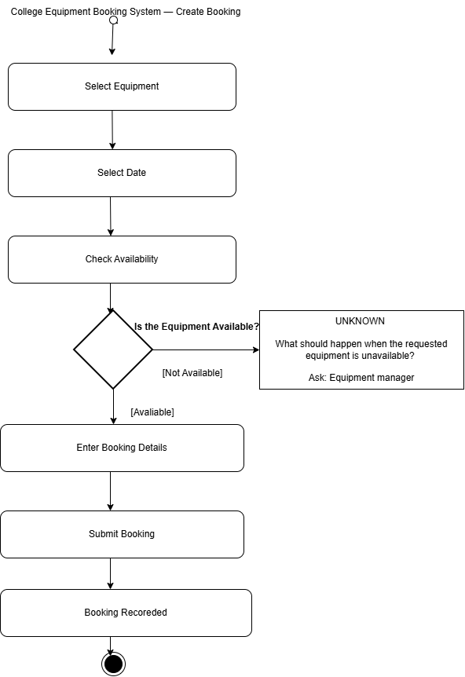

# Week 5 — Activity Diagram
Scenario: College Equipment Booking System 

## Part 2 — From requirement to process
Requirement: The system shall allow an authorised user to view equipment availability for a selected date.
- Likely performed by: Student
- Goal / use case: View Equipment Availability
- Three likely activities:
  1. Select a date
  2. Search for equipment
  3. View the availability list
- Unknown: Should unavailable equipment be shown (marked as booked) or hidden?
   
## 1. Process Modelled
Create Equipment Booking (from the Create Booking use case).

## 2. Purpose
To show what happens, step by step, when a user books equipment, and to find any decisions or missing rules in the process.

## 3. Activities
1. Select Equipment
2. Select Date
3. Check Availability
4. Enter Booking Details
5. Submit Booking
6. Booking Recorded

## 4. Decision and Guards
- Decision: Is equipment available?
- Guards: `[available]` → continue to Enter Booking Details
- `[not available]` → UNKNOWN (see below)

## 5. Unknowns
What should happen when the requested equipment is unavailable?

## 6. Stakeholder Question
Ask the equipment manager: "If the equipment someone wants is unavailable, should they just be told, be offered another item, or be added to a waiting list?"

## 7. Modelling Decision
I did not add a waiting list or an alternative-equipment step, because nothing in the case supports them. The unavailable path ends in a question instead of an invented rule.

## 8. Reflection
Drawing the decision point showed that the case says nothing about what happens when equipment is unavailable, which is a missing requirement.

---

## Project process plan — Scenario B
See the `project/3-models/` folder.
