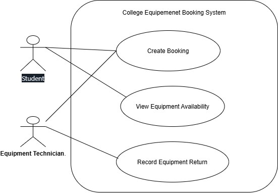
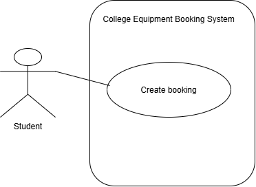

## Week 4 — Requirements Modelling
Scenario: College Equipment Booking System 

Second diagram (FR-02, Create Booking only):

## Requirement used
**FR-01:** The system shall allow an authorised user to view equipment availability for a selected date.
- Goal: find out whether equipment is free on a date
- Use case: View Equipment Availability
- Actor: Student and Equipment Technician. The exact role of "authorised user" is not established.
- Clarification question: Which users are authorised to view availability, students only or staff too?

**FR-02:** The system shall prevent an item being booked for an overlapping period.
- Goal: reserve equipment for a period
- Use case: Create Booking
- Actor: Student
- Clarification question: Can staff also create bookings on behalf of students?

## Actors
- Student
- Equipment Technician

## Use Cases
- View Equipment Availability
- Create Booking
- Record Equipment Return

## Modelling problems (Part 7)
| Example | What is wrong? |
|---|---|
| Database drawn as an actor | The database is part of the system, not an external role |
| Booking Screen drawn as a use case | A screen is UI design, not a user goal |
| Student placed inside the system boundary | Actors are external to the system |
| "Do Stuff" used as a use case name | Not a meaningful goal; use verb + noun |
| Every stakeholder added as an actor | Only roles that interact directly with the system are actors |

## Unknowns / Questions
- Can lecturers book equipment, and if so, do they get priority?
- Does the technician take part in Create Booking (e.g. approval)?

## Reflection
- **What the diagram helped me understand:** it shows the system boundary clearly. Things like buying or repairing equipment are outside it.
- **Question it revealed:** "authorised user" in FR-01 doesn't say which roles, so it's unclear whether lecturers should be an actor.
