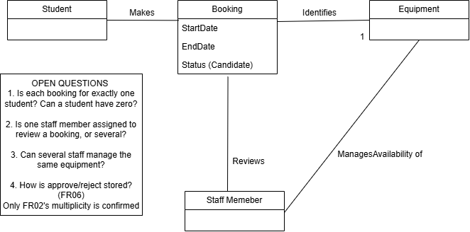
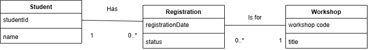

# Week 6 — Conceptual Class Diagrams
(Lab asks for Week6_Notes.docx — paste this into Word and save as .docx)

## Task A1
1. FR01 and FR02 show that Booking is an important concept.
2. FR03 identifies two attributes of Booking: start date and end date.
3. FR04 (reviews booking requests) and FR05 (manages equipment availability) involve Staff Member.

## Task B1 — Candidate concepts
| Candidate | Class, attribute or action? | Supporting requirement |
|---|---|---|
| Student | Class | FR01 |
| Booking | Class | FR01, FR02 |
| Start date | Attribute of Booking | FR03 |
| Equipment | Class | FR02 |
| Review | Action | FR04 |
| Staff Member | Class | FR04, FR05 |

## Task B2 — Main classes
- **Student**: makes bookings for equipment (FR01).
- **Booking**: the central record of who has what and when (FR02, FR03).
- **Equipment**: the item being booked (FR02).
- **Staff Member**: reviews bookings and manages availability (FR04, FR05).

## Task B3 — Uncertainty
A student's email address could be useful for contacting them, but no requirement confirms it. The department administrator would need to confirm this.

## Diagram

## Task E2 — Multiplicity
| Association | What is known? | What needs clarification? |
|---|---|---|
| Student—Booking | FR01: a student can make more than one booking | Is a booking for exactly one student? Can a student have zero bookings? |
| Booking—Equipment | FR02: each booking identifies exactly one item (1 at Equipment end) | How many bookings can reference the same item over time? |
| Staff Member—Booking | FR04: staff review requests | Is one reviewer assigned, or can several review the same booking? |
| Staff Member—Equipment | FR05: staff manage availability | Can several staff manage the same equipment? |

## Task E3 — Open questions
1. Is each booking for exactly one student?
2. How many staff members review a single booking?
3. Can several staff members manage the same equipment?
4. How is the approve/reject decision (FR06) recorded?

## Task F1 — Requirements-to-model check
| Requirement | Where in the diagram? | Fully represented? |
|---|---|---|
| FR01 | Student—Booking relationship | Partially (multiplicity not confirmed) |
| FR02 | Booking—Equipment relationship and 1 | Yes |
| FR03 | Booking attributes startDate, endDate | Yes |
| FR04 | Staff Member—Booking relationship | Partially |
| FR05 | Staff Member—Equipment relationship | Partially |
| FR06 | Booking status (candidate) | Needs clarification |

## Task F2 — Comparison with earlier models
The use case diagram has no Staff Member reviewing bookings, but FR04 says staff review requests. The use case model may need an extra use case once this is confirmed.

## Part G — Campus Workshop Registration

**G1 Classes:** Student, Workshop, Registration
**G2 Attributes:**
- Student: studentId, name (WR01)
- Workshop: workshopCode, title (WR02)
- Registration: registrationDate, status (WR07)

**G3/G4 Associations and multiplicities:**
- Student 1 —has— 0..* Registration (WR03, WR04)
- Registration 0..* —is for— 1 Workshop (WR05, WR06)

**G5:**
1. One Student can have **0..*** Registration records.
2. Each Registration belongs to **1** Student.
3. One Workshop can have **0..*** Registration records.
4. Each Registration is for **1** Workshop.

## Part H — Scenario B project draft
See `Project_Domain_Draft.drawio` and the `project/3-models/` folder.
