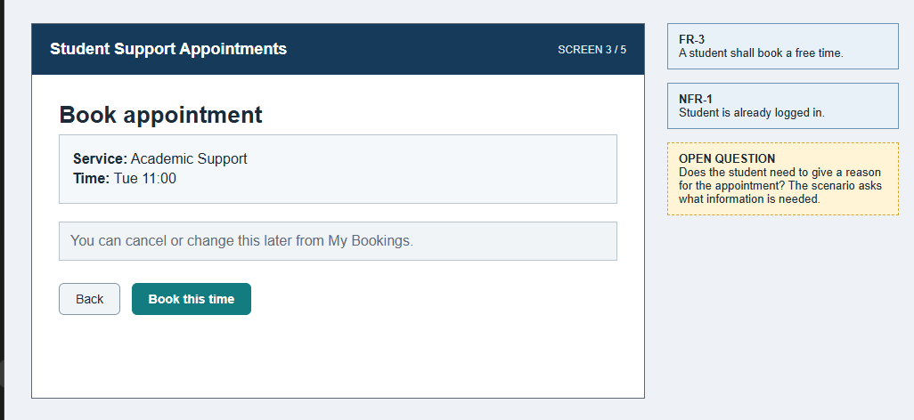
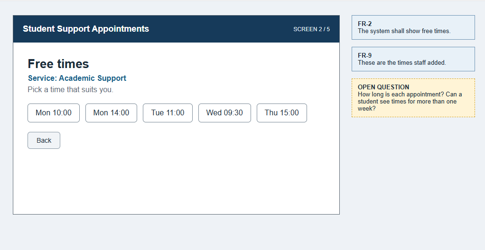
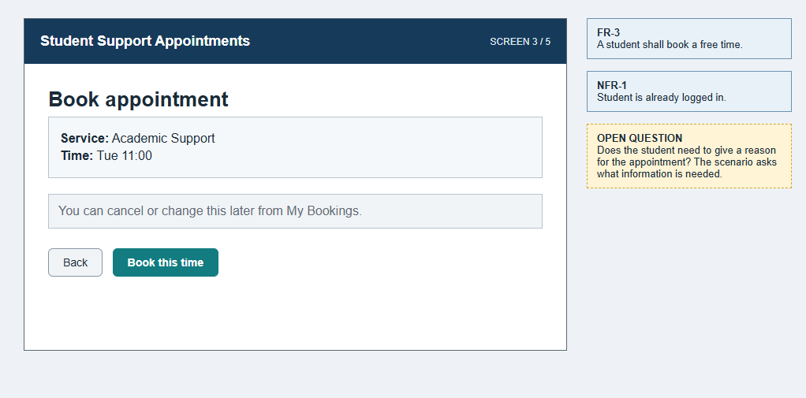
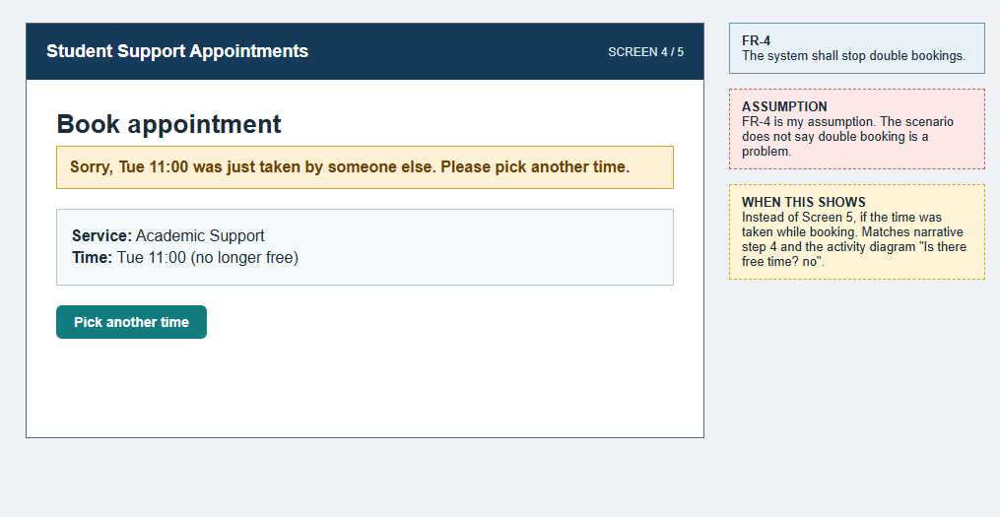
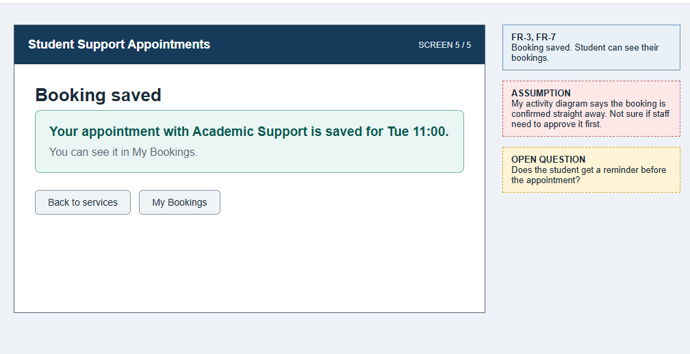

# 4. Prototype

## 4.1 Journey and purpose

User: A student
What they want to do: Book an appointment with a support service
What I want to find out: If students know which service to pick, what details they need to give, and if the booking is confirmed straight away

## 4.2 Prototype screens

### Screen 1 - View Services

Student picks which support service they need. FR-1

### Screen 2 - View Free Times

Student sees free times for that service. FR-2, FR-9

### Screen 3 - Book Appointment

Student checks the service and time and books it. FR-3

### Screen 4 - Time no longer free

If someone else took the time, the student is sent back to pick another. FR-4 (assumption)

### Screen 5 - Booking done

Tells the student the booking is saved. FR-3, FR-7. Not sure yet if staff need to approve it

## 4.3 Walkthrough and findings

Self-review. I went through the screens myself as a student booking an appointment. This is not checked with real stakeholders.

| What I found | What I'll do |
|--------------|--------------|
| I don't know how long an appointment is | Added to unknowns in section 1 |
| No rule for what info a student gives when booking | Added to unknowns in section 1 |
| Not sure if a booking is confirmed straight away or needs staff to approve it | Added to unknowns in section 1 |
| The student only picks a service, never a staff member | Check with support staff |
| Reminders were not shown anywhere | Added to unknowns in section 1 |
