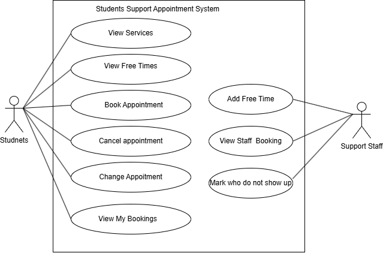
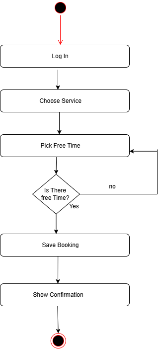

# 3. Requirements Models

## 3.1 Use Case Diagram

What students and staff can do.

## 3.2 Use Case Narrative - Book Appointment
| | |
|---|---|
| Who | Student |
| Before | Logged in |
| After | Booking saved |

| Student | System          |
|---------|-----------------|
| 1. Picks a service        |
| 2. Shows free times       |
| 3. Picks a time           | 
| 4. Checks it's still free |
| 5. Saves it               |

If the time is gone at step 4, go back to step 2.

## 3.3 Activity Diagram

The steps to book. If the time is taken, pick another one.

## 3.4 UML Class Diagram
.png>)

| Link | Numbers | Why |
|---|---|---|
| Student - Booking | 1 to 0..* | A student can have lots of bookings |
| Booking - TimeSlot | 0..1 to 1 | A time can only be booked once |
| Staff - TimeSlot | 1 to 0..* | Staff add their own times |
| Service - Staff | 1 to 1..* | Each service has staff (my guess) |
