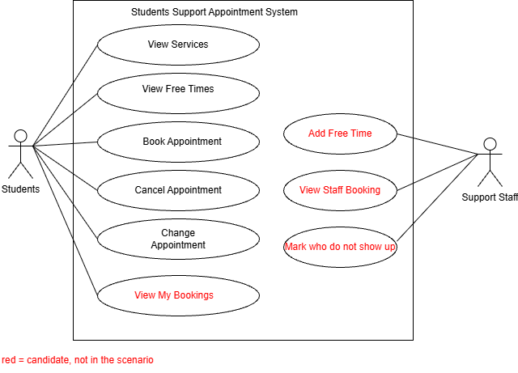
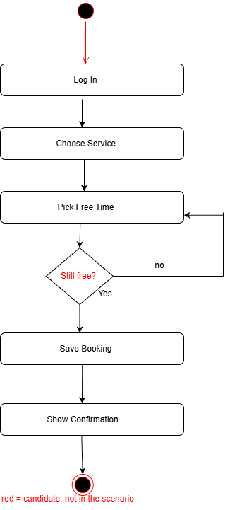

# 3. Requirements Models

## 3.1 Use Case Diagram

What students and staff can do.

## 3.2 Use Case Narrative - Book Appointment
|        |               |
|--------|---------------|
| Who    | Student       |
| Before | Logged in     |
| After  | Booking saved |

| Student                   | System                    |
|---------------------------|---------------------------|
| 1. Picks a service        |                           |
|                           | 2. Shows free times       |
| 3. Picks a time           |                           |
|                           | 4. Checks it's still free |
|                           | 5. Saves it               |

If the time is gone at step 4, go back to step 2.

## 3.3 Activity Diagram

The steps to book. If the time is taken, pick another one.

## 3.4 UML Class Diagram
.png>)

| Link               | Numbers   | Why                                 |
|--------------------|-----------|-------------------------------------|
| Student - Booking  | 1 to 0..* | A student can have lots of bookings |
| Booking - TimeSlot | 0..1 to 1 | A time can only be booked once      |
| Staff - TimeSlot   | 1 to 0..* | Staff add their own times           |
| Service - Staff    | 1 to 1..* | Each service has staff (my guess)   |

end time, status and attend in my class diagram are my own ideas. theyre not in the brief so i need to check them with the stakeholders

## 3.5 Model consistency check
Most of it lines up. Every main use case has its own FR, like Book Appointment is FR3 and Add Free Time is FR9. The activity diagram and the narrative go through the same steps and both send you back if the time is gone which is FR4

The more I looked at them the more gaps I found. Login is the first step in the activity diagram but its not on the use case diagram. I left it off cause NFR1 already covers it
* the timeslot has an end time but I still dont know how long an appointment is - Q5
* the student picks a service but never a staff member and I dont know who decides that - Q11
* booking has a status but I never said what the statuses are or if approved is one - Q12 and A4
* the 0..1 in the class diagram only works if FR4 is right and thats just my guess. if double booking is allowed the diagram would need to change
